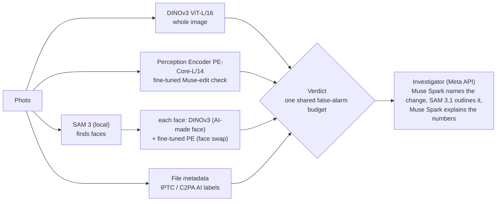

# ImageDETECTIVE

**Is this photo real, made by AI, or changed by AI?** ImageDETECTIVE checks one photo and gives one clear verdict, a calibrated confidence and **where** the evidence is: an evidence map of the whole image, a box and a score for every face (AI-made faces and face swaps), and an investigator step in which Meta's Muse Spark names what was most likely changed and SAM 3.1 outlines it.

Built for the **Meta Global AI Developer Hackathon 2026** (Indie Developer track, theme "Build for Your World"), 26 Oct – 4 Nov 2026. **Built with DINOv3**, Meta's Perception Encoder, SAM 3 / SAM 3.1, Muse Image and Muse Spark.

> **Live demo:** https://136-114-230-97.sslip.io (until 9 Nov 2026; about 10 s per photo on a CPU server) · **3-minute video:** *link follows*

## Why

Fake and AI-edited photos travel fastest as forwarded messages, for example on WhatsApp in India, where I live. The people who receive them, and the fact-checkers and journalists they ask, need a quick answer they can trust, and one that **rarely calls a real photo fake**. In May 2023 a single AI image of an explosion near the Pentagon went viral and briefly moved the US stock market.

ImageDETECTIVE is built for that flow: everyday phone photos, compressed and forwarded copies, screenshots and crops, group photos, and the newest AI images, including Meta's own Muse Image.

## Results at a glance

Whole-photo numbers are the final app's verdict (whole image, edit check and faces together) **from the pixels alone**, unless marked otherwise; face-swap numbers are measured on face crops at the app's red line; rows marked \* come from tests run before the last recalibration (3 Nov) or at a training-time line. A file that still carries its AI label is caught in every case. Details and commands: [results/](results/).

| AI images (most never used in training) | Caught |
|---|---|
| **Muse Image**, fresh test of 100 new prompts made on the last day (people, groups, low light, animals, food, scenes) | **100%** |
| Muse Image, **cropped and re-saved**\* (Meta's watermark-based detector missed 55% of cropped Muse images, Reuters, July 2026) | **100%** |
| Pictures made by hand in the apps judges are likely to use: **ChatGPT / Meta AI / Nano Banana Pro / Nano Banana 2.1** (20 each) | **100% / 100% / 95% / 60%** |
| The same 80 files as downloaded (their AI label read from the file) | 100% |
| Generators never used in training: **PixArt-Σ / SDXL** | 98% / 92% |
| GAN faces (thispersondoesnotexist / SFHQ) | 95% / 92% |
| Muse Image edits of real photos: whole-image changes / local changes ("add a red bicycle") | 88% / 71% |
| **Face swaps**, per face crop (turns red): photo swaps (OpenForensics test, app line) / today's swap tools inswapper + UniFace on people never seen (RTFS-10k test\*, training-time line on Colab) / DFDC video swaps (app line) | **97% / 89% / 39%** |

| Real photos called AI (any AI verdict) | n | Result |
|---|---|---|
| **My new selfies**, taken for the final test (private, offline) | 30 | **0%** |
| My new phone photos of objects and places, final test (private, offline) | 30 | 10% (3, all "Likely", none "AI-generated") |
| My phone photos (calibration, private, offline) | 104 | 0% |
| Polished professional photos (Wikimedia Commons, held out) | 330 | 4.8% |
| Amateur photos (OpenImages, held out / used nowhere before) | 76 / 576 | 1.3% / 1.7% |
| Real faces flagged as a swap: photo pools (polished, OpenImages, close-ups, selfies, my phone photos) / video frames (DFDC) / SID-Set | 1,358 / 1,452 / 292 | **0%** / 0.5% / 0.3% |

**Forwarded copies\*** (WhatsApp-like JPEG, a second forward, 800-px copies, screenshots, 70% crops; whole image and edit check, no faces): compression and screenshots add no false alarms on the real photos tested (polished 2.0–2.7%, OpenImages 0–0.7%), but **cropping raised polished photos from 2.7% to 4.7%**; Muse Image stays at 100% in every version ([robustness](results/robustness_final_v1.txt)).

## What you get for one photo

| Verdict | When |
|---|---|
| **AI-generated** | The whole-image score is above every real photo we tested, or the file itself carries an "AI-made" label |
| **Likely AI-generated** | The whole-image score is above the calibrated AI line |
| **Likely AI-edited** | The Muse-edit check (Perception Encoder) is above its line: the photo was re-rendered by an AI image model |
| **This face looks AI-made or AI-changed** | One face is above a strict line: AI-made face or face swap |
| **Likely authentic** | Nothing points to AI. Always shown with: *"This photo doesn't look AI-made or AI-changed. It doesn't confirm when or where it was taken."* |
| **Uncertain** | Everything in between. We would rather say this than guess |

Next to the verdict: a calibrated confidence, the **evidence map**, numbered **face boxes** with their own scores (red = changes the verdict, orange = some signs, green = no clear signs), a table of everything that was checked (including the file's metadata), and the **investigator**: Muse Spark names what was most likely changed, SAM 3.1 outlines it, and Muse Spark explains the numbers in 2–3 plain sentences.

## How it works



1. **Whole image (DINOv3).** The photo is resized so its long side is 448 px (never squashed). A frozen DINOv3 ViT-L/16 gives one feature vector per 16 × 16 patch, and a linear head scores every patch. The image score is *exactly* the average of the patch scores, so the evidence map shows what really produced the score. The head was trained on real photos and AI images from the same kinds of sources (same-content pairs made from Muse Spark captions, 7 generators, GAN faces, real close-ups and selfies), so it cannot learn "portrait = real" or "PNG = AI".
2. **Muse-edit check (Perception Encoder).** Muse Image edits **re-render every pixel** of a photo, so a Muse edit is an AI image as a whole, but a subtle one: frozen DINOv3 let 75% of local edits through. The middle layers of Meta's Perception Encoder separate edits from their own real originals far better (AUC 0.97 vs. 0.75), so we fine-tuned all 304M weights of PE-Core-L/14 on ~7,400 Muse renders against ~14,900 real photos, plus Muse edits of my own selfies. A second head on the same features adds Google's Gemini pictures.
3. **Faces (SAM 3).** SAM 3 runs locally with the prompt "face". Each face is scored twice: by the DINOv3 head (AI-made face) and by a **separate Perception Encoder fine-tuned on face crops for face swaps** (Colab A100, 20,000 steps): photo swaps (OpenForensics), video swaps (DFDC), today's swap tools (inswapper and UniFace, RTFS-10k), and real faces from six sources (FairFace, Open Images, FaceID-550, Indian faces, SID-Set, Commons) so that beauty filters and phone processing don't look like swaps.
4. **File metadata.** An IPTC "trainedAlgorithmicMedia" label (Muse Image, ChatGPT and Gemini write one) or a C2PA manifest is strong evidence; a missing label proves nothing, because forwarding strips it.
5. **Verdict and calibration.** All checks share **one false-alarm budget**: in every real-photo pool, at most 5% of real photos may get any AI verdict; the edit check alone at most 2%, a red face at most 0.5% of the real faces. The pools include my own phone photos, selfies and phone photos without people, measured offline on my laptop. Scores are temperature-scaled; "Uncertain" is capped at 15% of a balanced mix.
6. **Investigator (Meta Model API).** Muse Spark names the single object most likely added or changed and SAM 3.1 outlines it (on 151 local Muse edits it named an object in 28; for those 28, SAM 3.1's outline landed on the truly changed area 96% of the time, so the outline is a hint, not a guarantee); for AI-made photos SAM 3.1 outlines the object at the hottest spot of the evidence map. Muse Spark then writes 2–3 sentences **from our numbers only**. The verdict never comes from Muse Spark and never waits on an API.
7. **Try to fool it.** Type a prompt; **Muse Image** makes the picture, ImageDETECTIVE checks it at once, and "crop and re-save" shows what happens when the file's AI label is lost.

## Meta models: what each one does

| Model | Where it runs | Its job in ImageDETECTIVE |
|---|---|---|
| **DINOv3** ViT-L/16 (`facebook/dinov3-vitl16-pretrain-lvd1689m`) | Locally, frozen | The whole-image detector and the AI-made-face score; patch scores give the evidence map |
| **Perception Encoder** PE-Core-L/14-336 | Locally, **fine-tuned by us twice** | The Muse-edit check (whole photo) and the face-swap check (face crops) |
| **SAM 3** (`facebook/sam3`) | Locally | Finds every face (training data and app use the same prompt, threshold and crop rule) |
| **SAM 3.1** | Meta Model API | Outlines the object Muse Spark names, or the object with the strongest evidence |
| **Muse Spark** (`muse-spark-1.3`, standard mode) | Meta Model API | Captions for the same-content training pairs; the investigator; the plain-language explanation |
| **Muse Image** (`muse-image-1.0`, standard mode) | Meta Model API | Two test sets, ~780 same-content training pairs and ~7,000 training and test edits; the "Try to fool it" tab |

Every model the app calls while running is a Meta model. Non-Meta tools were used only offline (data preparation and held-out tests), listed under [Data used](#data-used).

## How we kept the numbers honest

- **Same sources for real and fake.** Same-content pairs (a real photo → Muse Spark caption → Muse Image picture); RTFS swaps paired with the very clips they were made from, and those real clips re-encoded exactly like the swaps (otherwise "different video compression = swap" would have been a shortcut; checked automatically, [results](results/face_pe_v4.txt)).
- **Held-out generators and people:** SDXL and PixArt-Σ never in training; RTFS dev/test faces share neither the person nor the swapped-in identity with training; near-duplicate faces removed (OpenForensics reuses photos: 49% of its dev faces had a twin in training before cleaning).
- **Choices on dev, results on test:** e.g. the face-swap model was picked on dev sets among 8 checkpoints of a controlled experiment (with vs. without self-blended fakes: the self-blended fakes did not help).
- **A fresh final test:** a new Muse Image set generated on the last day, new selfies and object photos taken for the final test, and pictures made by hand in ChatGPT, Meta AI and Gemini.
- **What didn't work**, briefly: frozen DINOv3 on Muse edits (tuning it learned a "people-free scene = AI" shortcut, so the edit check moved to the Perception Encoder); an edited-region head trained on SID-Set (24% of SID-Set edits, 0% of Muse edits); anomaly detection on real photos only (chance level); Muse Spark as a detector (AUC 0.61–0.69, so it never decides); more Google pictures for Nano Banana (no gain).

## Known limits

- **Nano Banana 2.1** (Google): 60% caught from pixels (35% "Uncertain"); its original files are caught through their AI label, forwards lose it. **SD 3.5:** about half.
- **Small local AI edits:** 71% caught, about 60% after a crop or heavy compression.
- **Polished stock photos and phone photos without people** are more often "Uncertain" (about 1 in 4 professional photos) and sometimes "Likely AI" (3 of my 30 final-test object photos; 11–12% of the professional Unsplash photos in the Chameleon benchmark\*, which keeps only AI images humans took for real: 79–82% of them caught).
- **Face swaps in tight video crops** (WildDeepfake): 14% turn red; photo swaps and today's swap tools are the strength.
- **Not in scope:** classic manual editing without AI, a real photo shared with a false story, documents, video. "Likely authentic" means "no AI traces found", not "proven real".

## Privacy and safety

- Uploaded photos are kept in memory only and deleted at most 30 minutes after their check (a background sweep runs every 30 s, also when nobody uses the app); they are never used for training. For photos not called authentic, the investigator sends a smaller copy to Meta's Model API in **standard mode**, where Meta doesn't train on it.
- Muse Image in the app makes pictures **from text prompts only**: it never edits uploaded photos, and it refuses prompts for real or famous people or their lookalikes (a word list, on top of Meta's own safety filter).
- All Muse edits for training and testing were made from **people-free** photos with free licences, or from photos of myself.
- My own phone photos and selfies stayed on my laptop: tests and calibration ran fully offline, and only totals left it.

## Run it yourself

**Note first:** the trained heads, the two fine-tuned Perception Encoders and their calibration files are **private and not in this repository** (they are trained partly on DFDC, whose frames may not be redistributed). Installing the code alone does not give a working detector: the app expects them under `weights/` (`google_v1/head_G3tt.pt` + `_calibration.json`, `edit_check_v3/` with `head_EC3pf.pt`, `head_EC3g.pt`, `pe_EC3.pt` + calibration, `face_pe_v4/` with `head_facepe.pt` and `pe_step14000.pt`), or downloads them at start from a private Hugging Face repo set in `HEADS_REPO`. To try it, use the [live demo](https://136-114-230-97.sslip.io). Every training step that makes these files is in the code.

Python 3.12. Install PyTorch for your GPU first (see [requirements.txt](requirements.txt)), then:

```bash
pip install -r requirements.txt
huggingface-cli login        # needs access to facebook/dinov3-vitl16-pretrain-lvd1689m and facebook/sam3 (gated)
python -m app.server         # http://127.0.0.1:7860
```

The investigator and "Try to fool it" need a Meta Model API key (`MODEL_API_KEY` in the environment or in `.env`); the daily spending cap is `API_DAILY_CAP_USD` (default $3). Without a key, the app still gives the full verdict. The hosted demo runs on a Google Cloud C3 CPU machine in bf16 ([deploy/gcp_vm_setup.sh](deploy/gcp_vm_setup.sh)); on a laptop GPU a photo takes about a second.

Training code: [src/](src/), [scripts/](scripts/) and the Colab launcher [notebooks/colab_face_swap.ipynb](notebooks/colab_face_swap.ipynb).

## Data used

| Dataset | Link | Licence / terms | Used for |
|---|---|---|---|
| SID-Set (from SIDA, CVPR 2025) | [Hugging Face](https://huggingface.co/datasets/saberzl/SID_Set) | CC BY 4.0 | Training (real OpenImages photos, FLUX images); sources for pairs and edits; held-out real pools |
| Wikimedia Commons photos | [commons.wikimedia.org](https://commons.wikimedia.org); every photo with author, licence and link: [v1](data/attribution/commons_v1.csv), [v2](data/attribution/commons_v2.csv), [v3](data/attribution/commons_v3.csv), [v4](data/attribution/commons_v4.csv) | Per photo: CC0, CC BY (2.0–4.0) or public domain | Real training photos (professional, phone, selfies and portraits), held-out dev sets, sources for pairs and Muse edits |
| Wikimedia Commons AI-generated images | Categories "Images generated by …"; every file: [commons_ai_v1](data/attribution/commons_ai_v1.csv) | Per file: CC0, CC BY or public domain | Evaluation only |
| Muse Image pictures and edits, Gemini pictures (made for this project) | Meta Model API (`muse-image-1.0`, standard mode); Google Vertex AI and the Gemini app | Generated by us | Test sets from our prompts ([data/prompts](data/prompts)), same-content pairs, edits for training and testing, Gemini training and dev pictures |
| Stable Diffusion face dataset | [Kaggle](https://www.kaggle.com/datasets/tobecwb/stable-diffusion-face-dataset) | CC BY 4.0 | Training (SD 1.5 / 2.1 faces); SDXL faces held out |
| SD 3.5 Medium, Kandinsky 2.2, PixArt-Σ pictures (made for this project) | Generated offline on Kaggle with the official weights | Each model's licence (Stability AI Community; Apache 2.0; OpenRAIL++) | SD 3.5, Kandinsky: training and dev; PixArt-Σ: dev only |
| BitMind nano-banana | [Hugging Face](https://huggingface.co/datasets/bitmind/nano-banana) | MIT | Gemini 2.5 Flash Image pictures: training and dev |
| GAN faces: thispersondoesnotexist (TPDNE) collection, SFHQ part 3 | Kaggle | MIT; CC0 | Training and test (StyleGAN faces) |
| DFDC (Deepfake Detection Challenge) | [Kaggle competition](https://www.kaggle.com/competitions/deepfake-detection-challenge) | Competition data terms; paid actors who agreed to the use and manipulation of their likeness | Face-swap training (parts 0–2; part 3 for development). Frames, crops and weights kept private |
| OpenForensics (ICCV 2021) | [Zenodo](https://zenodo.org/records/5528418) | CC BY 4.0 | Face-swap training (Val, Train, Test-Challenge); Test-Dev sample held out for testing |
| RTFS-10k (RealTimeFaceSwap-10k) | [Kaggle](https://www.kaggle.com/datasets/stplusplus/rtfs-10k) | CC BY-SA 4.0 (clips from Creative Commons YouTube videos) | Face-swap training, dev and test (inswapper and UniFace swaps and their real clips); photos of children skipped |
| FairFace | [GitHub](https://github.com/joojs/fairface) | CC BY 4.0 | Real faces (training) |
| Open Images V7, "Human face" | [Open Images](https://storage.googleapis.com/openimages/web/index.html) | Images CC BY 2.0, each with author and licence: `data/attribution/openimages_faces_v1.csv` | Real faces (training) |
| FaceID-550 | [Mendeley Data](https://data.mendeley.com/datasets/zs2vnf9692) | CC BY 4.0 | Real faces (training; 103 people held out as a dev pool) |
| Indian face images with various expressions | [Mendeley Data](https://data.mendeley.com/datasets/zfcd4bny82) | CC BY 4.0 | Real faces (training) |
| WildDeepfake | [Hugging Face](https://huggingface.co/datasets/xingjunm/WildDeepfake) | Hugging Face lists Apache 2.0; the authors' [GitHub](https://github.com/OpenTAI/wild-deepfake) states research-only use | Evaluation only (test split) |
| Chameleon | [AIDE GitHub](https://github.com/shilinyan99/AIDE) (images via the copy the authors pointed to, [issue #1](https://github.com/shilinyan99/AIDE/issues/1)) | Academic research only; used for evaluation only, with the authors' informed permission. Images not shared here | Evaluation only |

Offline tools (never called by the app): YuNet face detector (OpenCV, MIT) for face-crop measurements; Kaggle, Colab and Google Cloud GPUs/CPUs; FFmpeg/x265 to re-encode the RTFS real clips.

### References

- **Chameleon:** S. Yan, O. Li, J. Cai, Y. Hao, X. Jiang, Y. Hu, W. Xie, *A Sanity Check for AI-generated Image Detection*, [arXiv:2406.19435](https://arxiv.org/abs/2406.19435).

```bibtex
@article{yan2024sanity,
  title={A Sanity Check for AI-generated Image Detection},
  author={Yan, Shilin and Li, Ouxiang and Cai, Jiayin and Hao, Yanbin and Jiang, Xiaolong and Hu, Yao and Xie, Weidi},
  journal={arXiv preprint arXiv:2406.19435},
  year={2024}
}
```

- **DFDC:** B. Dolhansky et al., *The DeepFake Detection Challenge (DFDC) Dataset*, [arXiv:2006.07397](https://arxiv.org/abs/2006.07397); *The Deepfake Detection Challenge (DFDC) Preview Dataset*, [arXiv:1910.08854](https://arxiv.org/abs/1910.08854).
- **OpenForensics:** T.-N. Le, H. H. Nguyen, J. Yamagishi, I. Echizen, *OpenForensics: Large-Scale Challenging Dataset For Multi-Face Forgery Detection And Segmentation In-The-Wild*, ICCV 2021.
- **SID-Set / SIDA:** Z. Huang et al., *SIDA: Social Media Image Deepfake Detection, Localization and Explanation with Large Multimodal Model*, CVPR 2025.
- **FairFace:** K. Kärkkäinen, J. Joo, *FairFace: Face Attribute Dataset for Balanced Race, Gender, and Age*, WACV 2021.
- **WildDeepfake:** B. Zi, M. Chang, J. Chen, X. Ma, Y.-G. Jiang, *WildDeepfake: A Challenging Real-World Dataset for Deepfake Detection*, ACM MM 2020.
- Method background: *Rethinking Cross-Generator Image Forgery Detection through DINOv3* ([arXiv:2511.22471](https://arxiv.org/abs/2511.22471)); GenD ([arXiv:2508.06248](https://arxiv.org/abs/2508.06248)); B-Free ([arXiv:2412.17671](https://arxiv.org/abs/2412.17671)); RINE (ECCV 2024); self-blended images (Shiohara & Yamasaki, CVPR 2022).

## Built during the hackathon

Everything in this repository was written between 26 Oct and 4 Nov 2026: the data pipeline, every training and evaluation script, the calibration, the web app, the deployment and all results. **What existed before:** the pretrained Meta models, the public datasets above, and my earlier research on the same problem (no code reused). **Other tools:** PyTorch, timm, Hugging Face, FastAPI, OpenCV, FFmpeg, Kaggle, Google Colab, Google Cloud, Caddy, Claude Code.

## Background

I worked on the same problem in ImageCLEF 2026 ([paper](https://ceur-ws.org/Vol-4283/paper289.pdf)). That system called about 2 of 3 real images fake on the official test, because its real training photos were too narrow. This project was built from scratch with different models and a different architecture, around that lesson: real and AI images from the same sources, a false-alarm budget on real photos first, and honest held-out tests.

## Credits and licences

- The code in this repository is released under the [MIT Licence](LICENSE). It covers only the code written for this project.
- **Built with DINOv3** ([DINOv3 Licence](https://ai.meta.com/resources/models-and-libraries/dinov3-license)).
- **Perception Encoder** ([facebookresearch/perception_models](https://github.com/facebookresearch/perception_models), Apache 2.0; loaded with timm).
- **SAM 3 and SAM 3.1** ([SAM Licence](https://huggingface.co/facebook/sam3)); SAM 3.1 output parsed with Meta's `meta-sam-parser`.
- **Muse Image and Muse Spark** via the Meta Model API.
- Pretrained models and datasets keep their own licences (see [Data used](#data-used)).
